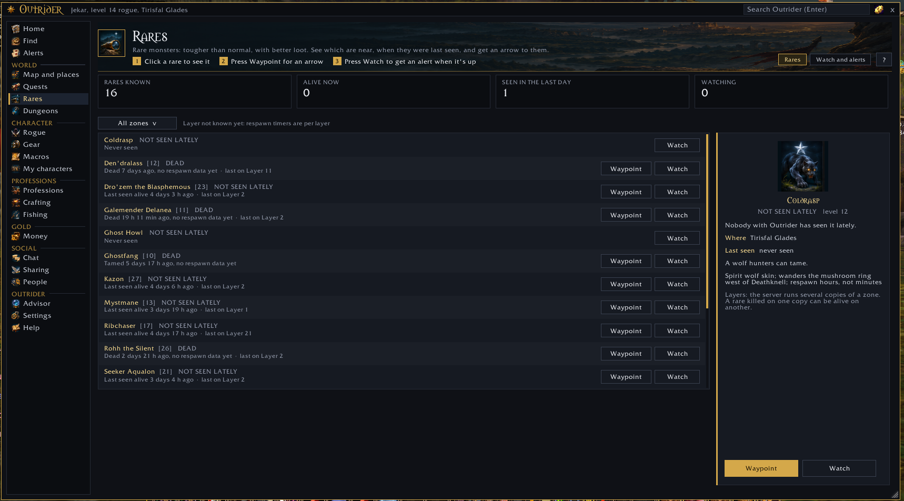
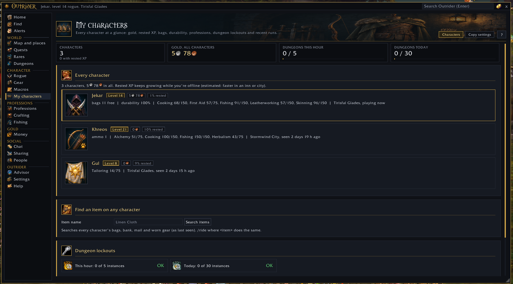
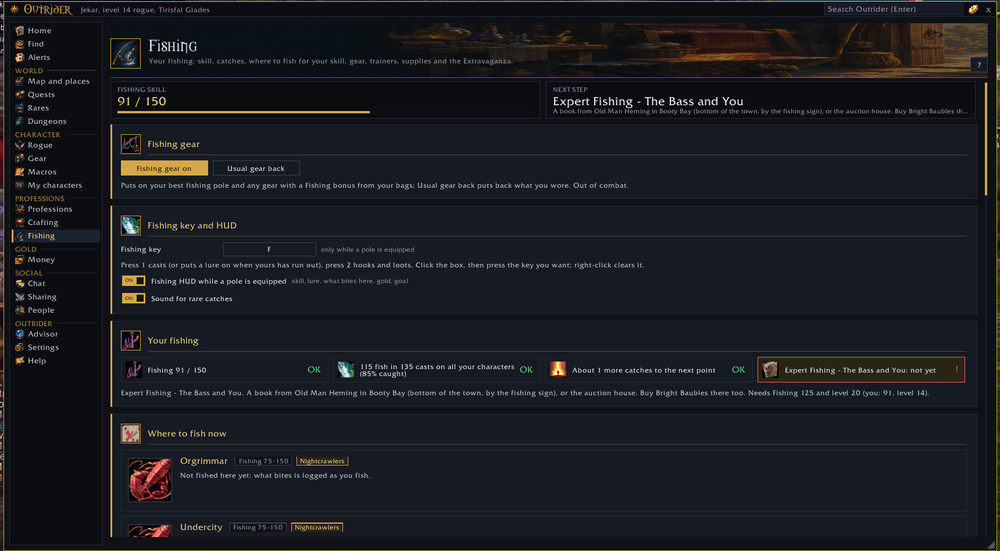

# Outrider for WoW Forever

**One addon to rule them all.** Outrider knows which character you're on (class, race, level, talents, professions, gold) and shows only what fits that character, in plain words, with one button to go there: your next step, quests and dungeons, the way to any place, rare alerts, hunter pet tools, macros for every class, professions, auction shopping, fishing and gear advice.

Advice only: every cast, target, buy and craft is your own click or key press. Nothing leaves your PC; sharing is off until you switch it on. No other addon needed.

**[Join us on Discord](https://discord.gg/NqsBsDPqy):** talk with other Outrider players, report bugs, ask for features and hear about new versions first.

## How to install (5 minutes, Windows)

You need World of Warcraft **Forever** installed and played at least once.

**1. Close World of Warcraft** completely.

**2. Download the installer:** click here: **[Download Install-Outrider](https://github.com/LackOfSkillz/outrider-releases/releases/latest/download/Install-Outrider.cmd)**

Your browser may say the file *"isn't commonly downloaded"*. That's normal for a new file.
- **Edge:** point at the download, click the **...** button, then **Keep**, then **Show more**, then **Keep anyway**.
- **Chrome:** click **Keep** (or the arrow next to the download, then **Keep**).

**3. Run it:** open your **Downloads** folder and double-click **Install-Outrider**.

A blue box may say *"Windows protected your PC"*. Click **More info**, then **Run anyway**. (It says this about any program that isn't from a big company.)

**4. Wait a few seconds.** A box says **Outrider is installed!** Click **OK**.

- If it can't find World of Warcraft, it asks you to pick the **World of Warcraft** folder (usually `C:\Program Files (x86)\World of Warcraft`).
- If WoW is still open, it asks you to close it and click **Retry**.

**5. Start the game.** On the character screen, click **AddOns** (bottom left) and make sure **Outrider** is ticked. If you see **Load out of date AddOns**, tick that too. Then click **Okay**.

**6. Log in and type `/ride`** (then press Enter). Outrider opens on **Home**, with your next step at the top.

### Updates

Close WoW and double-click **Update Outrider** on your desktop. That's it. Outrider also tells you in game when a newer version is out.

### Something went wrong?

| What you see | What to do |
|---|---|
| *"Windows wouldn't let the installer write to the WoW folder"* | Right-click **Install-Outrider**, choose **Run as administrator**. |
| Outrider isn't in the AddOns list | Close WoW completely (not just log out) and start it again. |
| Typing `/ride` does nothing | On the character screen, AddOns: tick **Outrider** and **Load out of date AddOns**. |

### Other ways to install

- **CurseForge app or WowUp:** search **Outrider Forever** (coming soon: the CurseForge project is waiting for approval).
- **By hand:** download the zip from the [newest release](https://github.com/LackOfSkillz/outrider-releases/releases/latest) and unzip it straight into `World of Warcraft\_forever_\Interface\AddOns`, so you get `AddOns\Outrider`, `AddOns\Outrider_Data_Quests` and so on (not one folder deeper).

## Found a problem or have an idea?

In game: open `/ride`, then **Help**, then **Report or idea** (or type `/ride report`). Pick one, say it in your own words, press **Make my report**, copy the link and paste it in your web browser. It opens a GitHub issue with everything filled in; click **Submit**. You can also [open an issue here](https://github.com/LackOfSkillz/outrider-releases/issues/new/choose).

## Screenshots

<table>
<tr>
<td width="50%" valign="top"> <b>Home</b>: Your next step, where to go, XP and rested, and six cards of quests, upgrades, dungeons, rares and errands.</td>
<td width="50%" valign="top"> <b>Find</b>: Search anything; best quest, gear upgrade and zone for your level, one Go away.</td>
</tr>
<tr>
<td width="50%" valign="top"> <b>Quests</b>: Every quest with its progress, reputation and an arrow to the nearest objective or turn-in.</td>
<td width="50%" valign="top"> <b>Dungeons</b>: Which dungeons fit your level, the quests to take along and who gives them.</td>
</tr>
<tr>
<td width="50%" valign="top"> <b>Rares</b>: Rare monsters near you, when they were last seen and on which layer, with a waypoint.</td>
<td width="50%" valign="top"> <b>Map and places</b>: The gold arrow to the nearest inn, vendor, flight master or any of your trainers.</td>
</tr>
<tr>
<td width="50%" valign="top"> <b>Your class</b>: Spells your trainer has for you now and next, and fight keys written from your spellbook.</td>
<td width="50%" valign="top"> <b>Macros</b>: Every macro for your class by level and build, explained line by line, drag to your bar.</td>
</tr>
<tr>
<td width="50%" valign="top"> <b>Gear</b>: Upgrades for your character and where to get them.</td>
<td width="50%" valign="top"> <b>My characters</b>: Gold, rested XP, bags, professions and lockouts for every character.</td>
</tr>
<tr>
<td width="50%" valign="top"> <b>Professions</b>: Your skills and what to do next for each.</td>
<td width="50%" valign="top"> <b>Crafting</b>: Pick recipes; Outrider adds up what you still need and what it costs.</td>
</tr>
<tr>
<td width="50%" valign="top"> <b>Fishing</b>: One-key fishing, your catches, where to fish for your skill and the next book to read.</td>
<td width="50%" valign="top"> <b>Sharing</b>: Everything is off until you switch it on: rares, gathering spots, gear for alts and family.</td>
</tr>
<tr>
<td width="50%" valign="top"> <b>Help</b>: Every feature, one topic at a time, with buttons that take you there.</td>
</tr>
</table>

## Open-source data packs

**Creator:** Gary Mix. The original Outrider code is GPL-3.0-only. Third-party data retains its own license and copyright notices.

Browse the [public source data packs](data-packs/). Currently, the **Words** pack is committed here under its original English Speller Database license. The QuestieDB-derived **NPC, Gear, Mobs, Nodes, Dungeons and Quests** source packs are now published in [data-packs](data-packs/), with the original upstream attribution and license; check the per-pack provenance.

The original source repository `LackOfSkillz/OAR` is private and was not made public by this change. A public release ZIP is not the same as a source tree. The six generated QuestieDB packs were exported from locally built sources with per-pack provenance, attribution and GPLv3 terms. Verify provenance before repackaging or redistribution.

See [data pack status and provenance](data-packs/README.md), [GPLv3 license](LICENSE), and [copyright and upstream attribution](COPYRIGHT.md).

