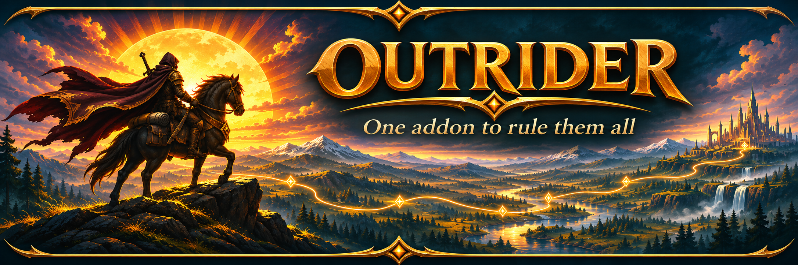

**[Join us on Discord](https://discord.gg/NqsBsDPqy):** talk with other Outrider players, report bugs, ask for features and hear about new versions first.

# One addon for WoW Forever.

Outrider looks at the character you're playing (class, race, level, talents, professions, gold) and shows only what fits that character, in plain words, with one button to go there. It replaces a stack of separate addons: quests, maps and arrows, rare alerts, macros, talents, professions, fishing, the auction house, gear advice and more, all in one window that talks to itself.

**Advice only:** every cast, target, purchase, talent point and craft is still your own click or key press. Outrider never plays for you.

## New: the Talents page

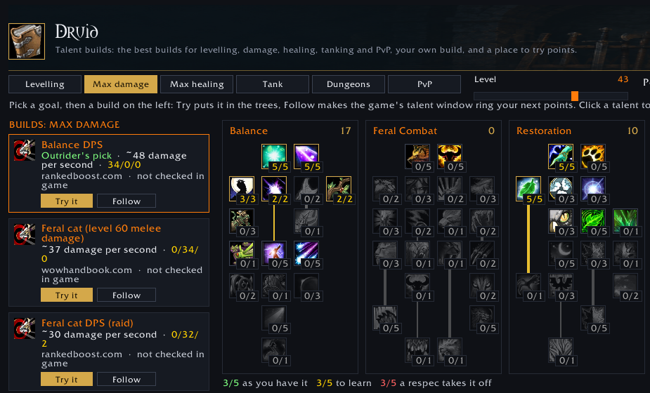

Your three talent trees on one screen, with researched builds for every class for levelling, max damage, max healing, tanking and PvP. Outrider estimates how each build does with *your* spells and marks its pick for you. Try any build, change points with the game's own rules, slide the level to see it as you grow, and press **Follow**: the game's talent window then lights up where your next point goes.

## Everything Outrider does

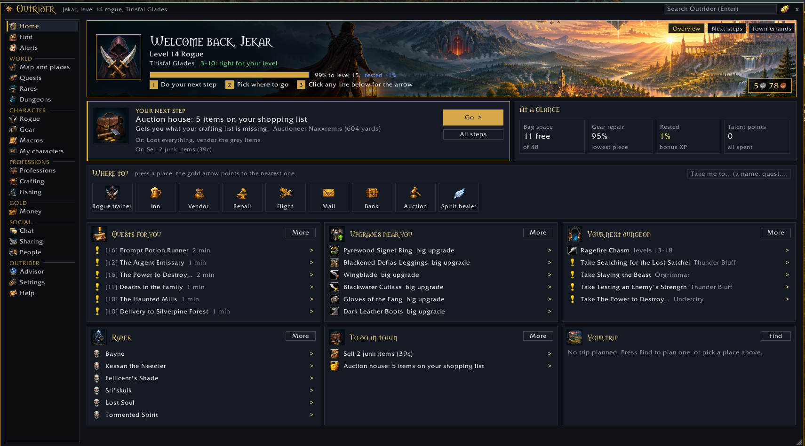

### Your next step
- **Home and What now?:** the next things worth doing for this character right now: errands, quests, gear, dungeons, training, gold.
- **Find:** one search box for any place, NPC, quest or item. The three best picks for you are on top; press **Go**.
- **Alerts feed:** every pop-up is kept, so nothing is lost when one fades.

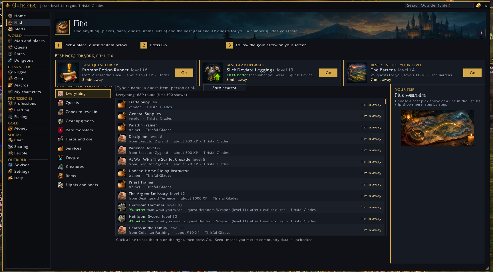

### Maps and travel
- **The way there:** a gold arrow and a line of dots to any place or quest, along roads walked before.
- **Trip planner:** flight masters, zeppelins, boats and skyboats are planned for you, with flight times.
- **Map pins:** vendors, trainers, flight masters, repair, mailboxes, rares, dungeon entrances, portals, herbs and ore.
- **Zone levels** on the world map, coordinates under the minimap, breadcrumbs to find your way back, and unexplored areas tinted.

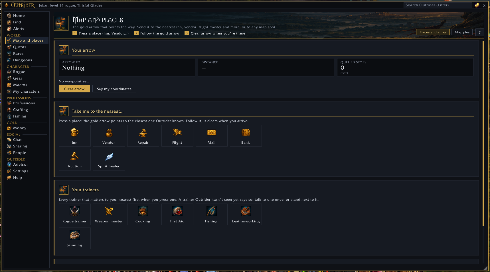

### Quests
- **Near me:** the quests worth doing next from where you stand, best first.
- **Quest chains**, breadcrumbs and what each step unlocks.
- **Objectives on the map and minimap**, quest marks on the mobs you need, and an arrow to the turn-in.
- **Quest tracker and journal:** by zone or level, with XP, and a diary of every quest you took.
- **Best quest reward** named at every turn-in.

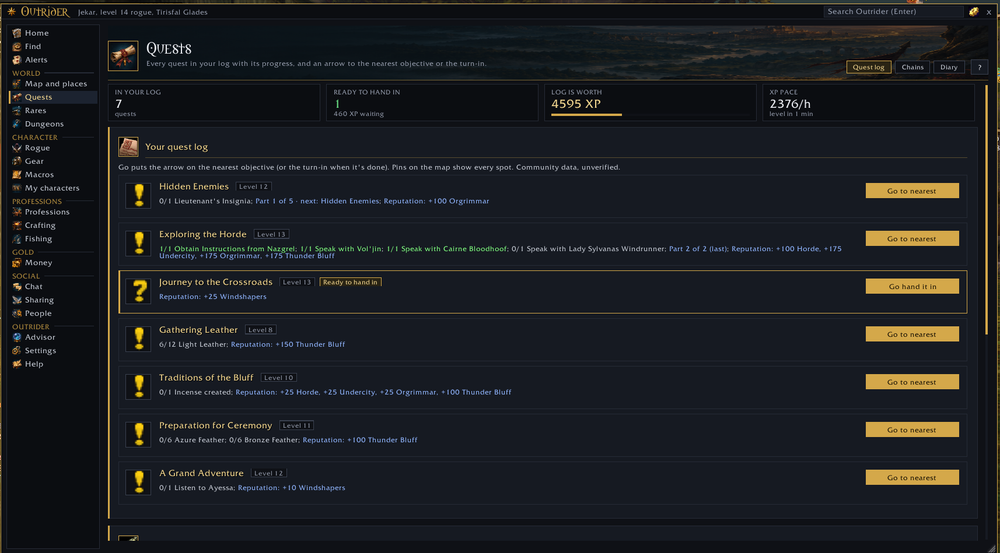

### Dungeons
- **Dungeons that fit your level**, with their quests and keys, who gives them and where they stand.
- **What each dungeon holds for you**, and how many runs you have left this hour and day.

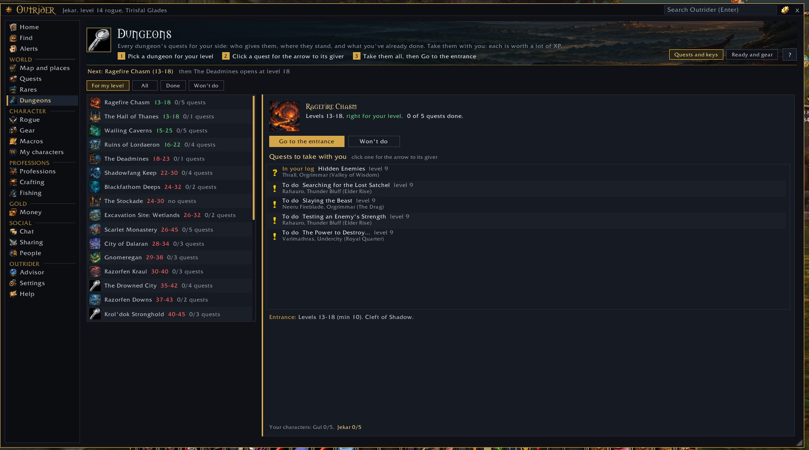

### Rares
- **Rare alerts:** a pop-up, a sound and a screen flash, blue for rares and red for rare elites, with a Target button.
- **A pulsing star** over a rare's nameplate, a watch list, and respawn windows worked out per layer.
- **Rare routes** and macros that always target the newest rare you saw.

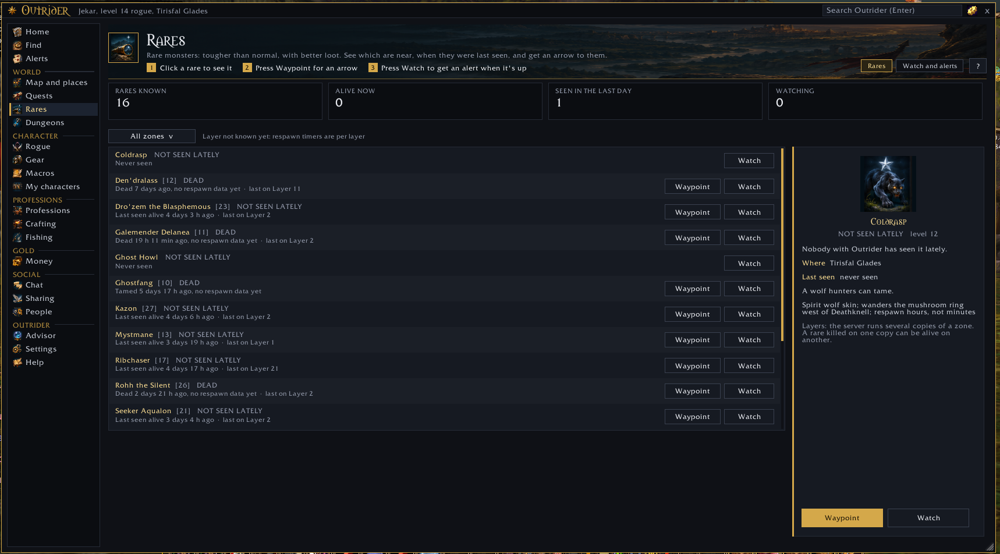

### Your class
- **Spells to learn** from your trainer's own list, checked against your spellbook, with an arrow to your class trainer.
- **Fight, Pull and Heal keys** for all nine classes, built for your spec and level, rewritten as you learn spells, and explained line by line. Caster keys start your auto attack too.
- **Talents page** (see above) and a talent advisor that rings your next point in the game's window.
- **Click-to-heal bars** for healers in a group.
- **Hunters:** pet panel (health, focus, abilities, feeding), tame helper, ammo warnings and beast tooltips.

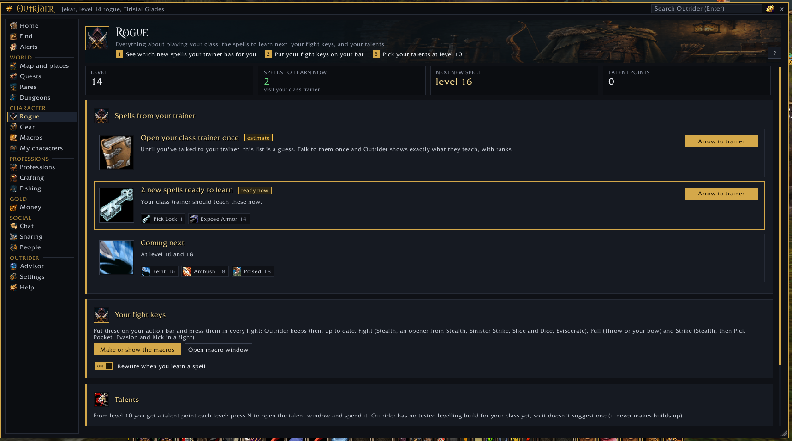

### Macros
- **A macro tree** laid out like the talent window: every ready-made key for your class, by level and build. Drag one to your bar.
- **Combined keys:** Stop, Save, Burst, Recover and Team, each one button with Shift, Ctrl and Alt layers.
- **Handy keys:** nameplates, vendor, status, next step and bag swap. Checks for old spell ranks and renamed spells.

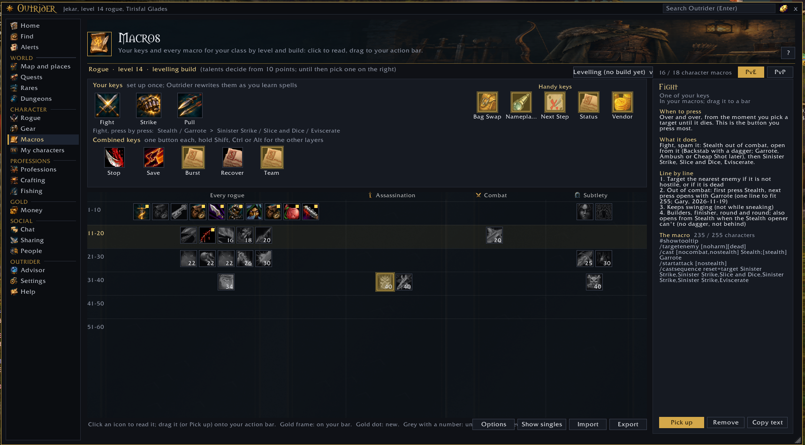

### Gear
- **Gear advisor:** every item scored for your class and build, with upgrades nearby, from quests, from dungeons and from your other characters.
- **Bag marks:** item level, a green arrow on upgrades, a gold coin on junk.
- **Need or Greed advice** in group rolls, gear sets, and gear you carry that's an upgrade for your alts.

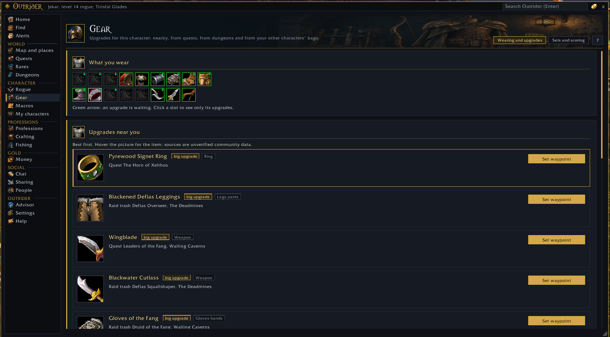

### Professions
- **What to make next** and where to get what you're missing: vendor, creature, herbs and ore, or the auction house.
- **Skill-up planner** with the cheapest recipes per point, a craft queue and its shopping list.
- **One-press crafting** and a training button for the next skill-up.

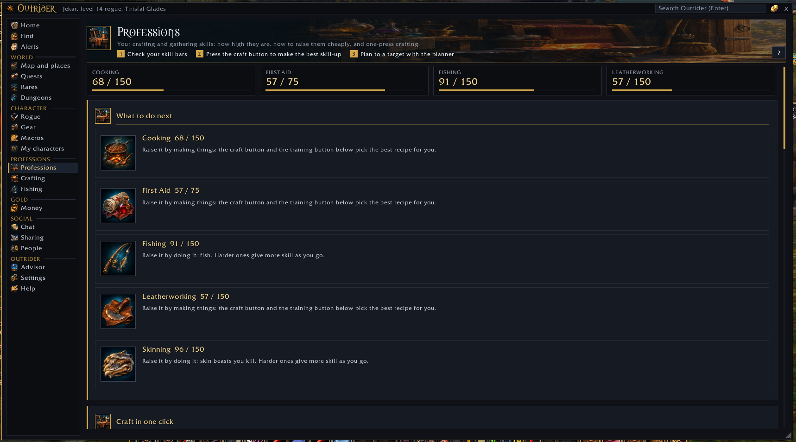

### Fishing
- **One key** casts and hooks the bobber, puts a lure on when it has run out, and swaps your weapons back.
- **Session in full:** fish, vendor gold and auction gold per hour, catches to your next point and to the cap, fish per hour with and without a lure.
- **Spots that bite best**, a wanted list counted from your bags, records, lures left, and the Stranglethorn Extravaganza countdown.

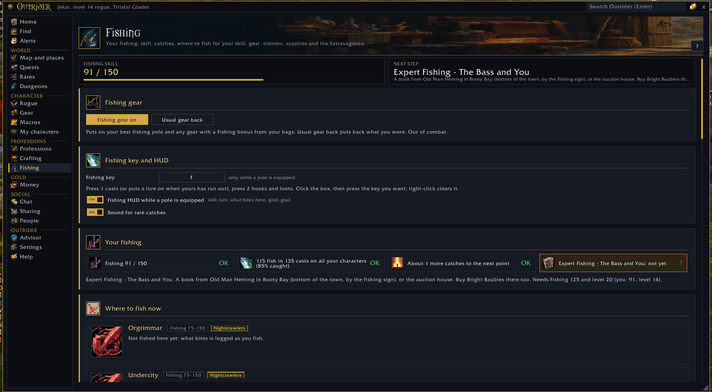

### Auction house
- **Shopping window:** skill-ups, weapons, armor and bags your gold covers, bought in one click (never more than the listing you saw).
- **Sell bags:** each item priced just under the cheapest seller and posted in one click; a risky price needs a second click.
- **My auctions:** undercut auctions flagged and cancelled one click at a time.
- **Search and shopping lists:** plain extras (exact name, level, under a price, quality, usable), recent searches, and Auctionator or TSM lists imported.
- **Deals:** vendor flips and resale in plain words (what you pay, what you get back, what you keep), sized to the gold you have.
- **Tooltips:** auction price, whole-stack price, and what disenchanting is likely worth.

### Gold
- **Money page:** the best ways to earn at your level and with your professions, and your own earnings per hour.
- **Gold ledger**, Merchant's Favor crates, and town errands (sell junk, repair, mail, train) in one pop-up.

### Your characters
- **My characters:** every character's level, gold, rested XP, professions and lockouts on one page.
- **Find any item** on any of your characters.

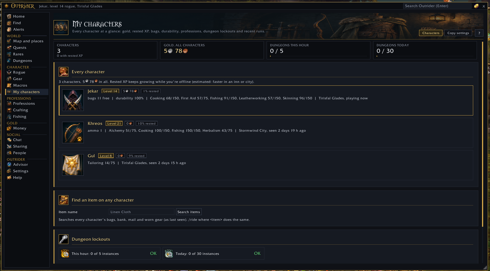

### Chat, look and comfort
- **Chat:** your name and watched words highlighted, spam hidden, LFG in its own tab, spell check while you type.
- **Info bar**, a clean dark skin for Blizzard windows, Edit Mode layouts per situation, bigger fonts and colour-blind colours.
- **Lag check and one-click bug reports** from the Help page.

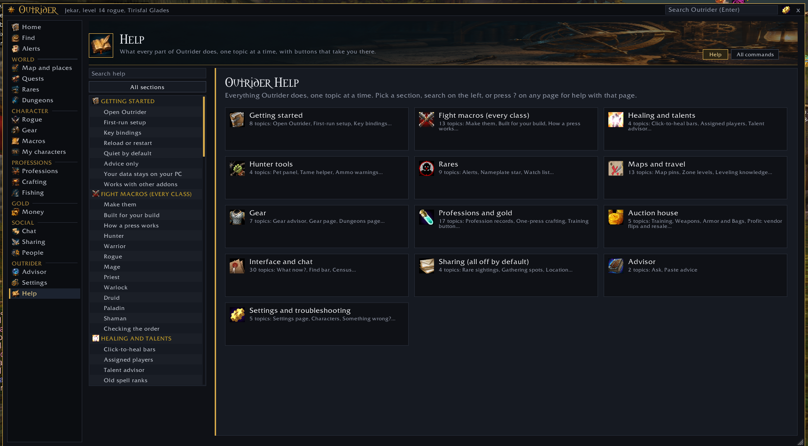

### Sharing (all off until you turn it on)
- **Rare sightings, herb and ore spots, and your location** with your guild or party, over the game's own addon channels only.

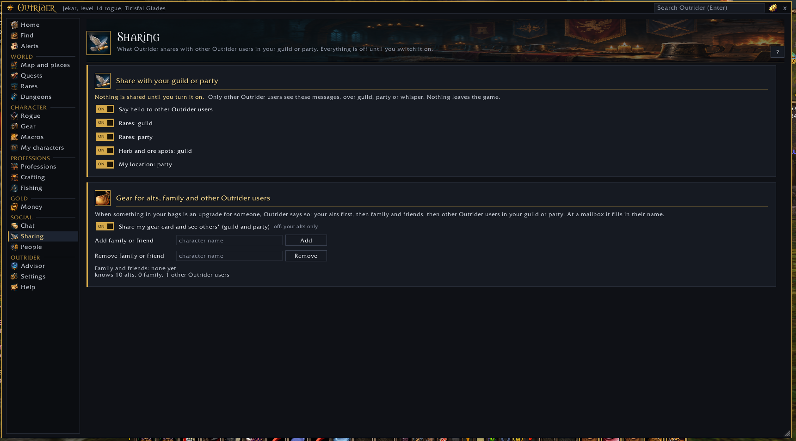

## Safe and private
- **Advice only.** Outrider shows what's worth doing and points the way. It never presses keys, casts, targets or plays for you.
- **Your data stays home.** Nothing leaves your PC. Sharing is off until you switch it on.
- **Stands on its own.** No other addon needed, and it steps aside for the ones you already use.
- **Honest data.** Anything not yet confirmed on WoW Forever says so until it's been seen in game.

## Give it one evening.

Install it. Log in. Type `/ride`. Press **Go** on the first thing it suggests, and see how far you get in an hour.

***One addon to rule them all.***

---

Quest, NPC, creature, herb and ore, gear and dungeon data is converted from QuestieDB and shared under the GNU GPLv3 (licence and source notes inside each data folder). Talent builds come from wowhandbook.com and rankedboost.com, credited on each build. Outrider is not made by or affiliated with the Questie team or Blizzard Entertainment. Created by Gary Mix. Licensed under GPLv3.
